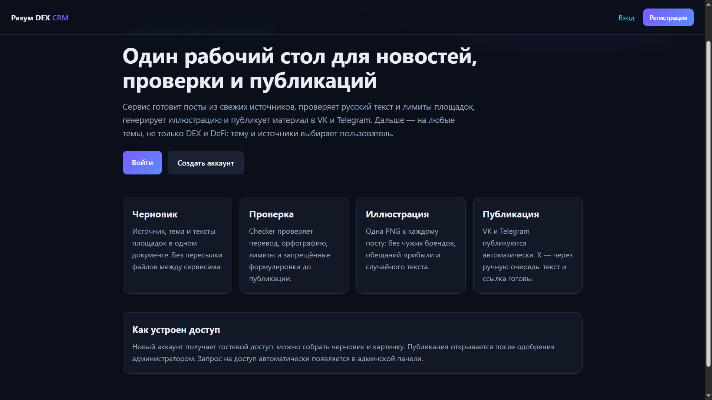
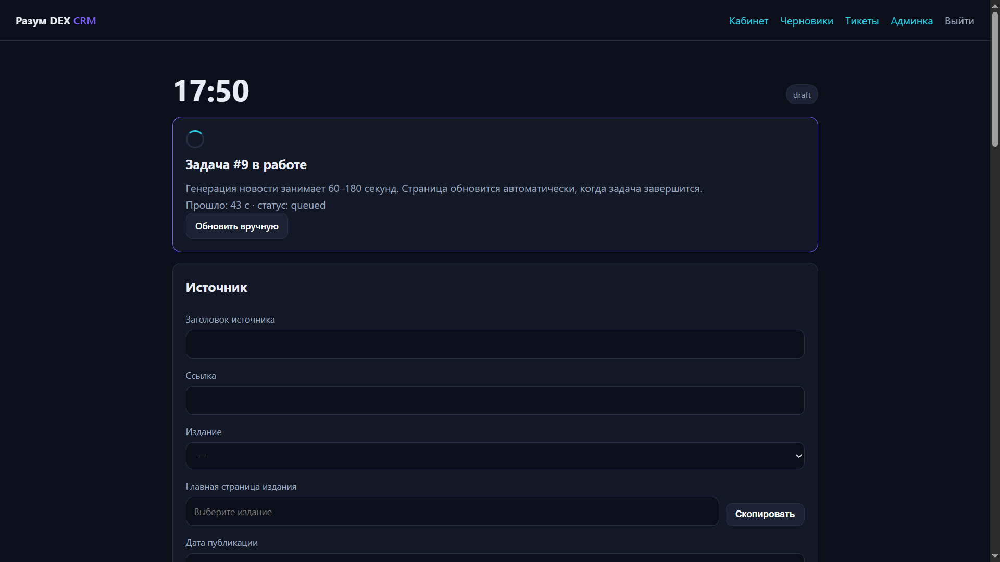
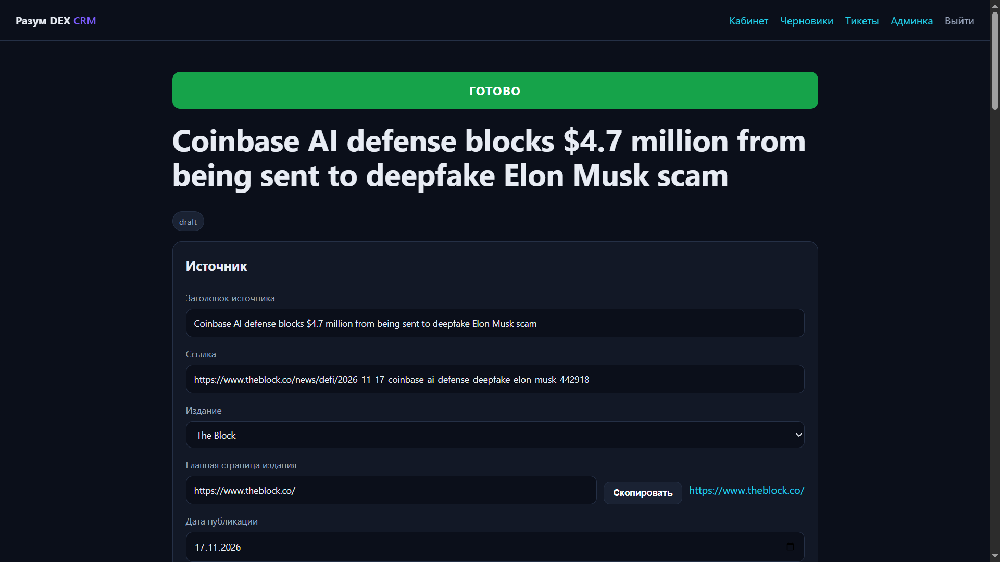
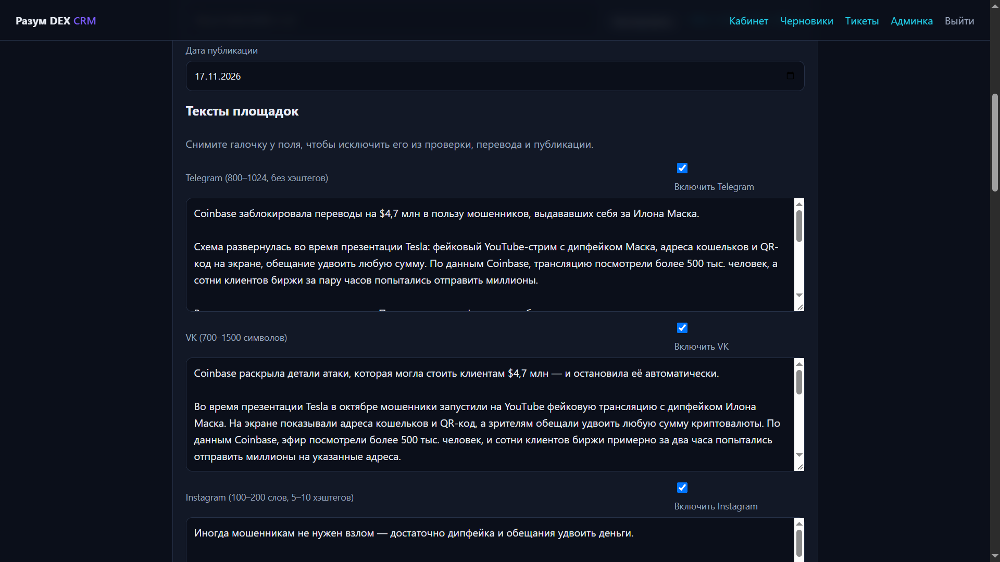

# rompetr-crm — Content Plant для «Разум DEX»

CRM-система для подготовки и публикации новостей в соцсети. Объединяет поиск новости,
редакторскую проверку, генерацию иллюстраций, модерацию и публикацию в VK и Telegram
в одном веб-интерфейсе. Внутри работает Claude Code: он переводит и проверяет тексты,
а также может собрать готовый пост из свежих источников по одной кнопке.

Проект вырос из локального конвейера Content Plant: JSON-посты, субагенты Checker и
Pixly, команда `/publish`. Теперь тот же пайплайн доступен через браузер и базу данных,
с пользователями, ролями, очередью задач и историей публикаций.



---

## Для кого

- **Редактор / SMM-специалист** — готовит посты для криптосообщества: DEX, DeFi, Web3,
  кошельки, безопасность, AI-агенты, торговые роботы.
- **Администратор сообщества** — модерирует черновики, управляет доступами и остатками
  гостевых лимитов, следит за очередью задач и публикациями.
- **Гость / новый пользователь** — знакомится с сервисом по гостевой квоте: черновик,
  поиск новости, генерация PNG и публикация после одобрения. По умолчанию доступны
  1 поиск, 2 картинки и 1 публикация; администратор может задать другой остаток.
- **Владелец проекта** — сопровождает CRM на VPS, управляет доступами, лимитами,
  соцсетями и подключением Claude Code.

---

## Какие боли решает

| Боль | Как решает CRM |
|---|---|
| Новости собираются вручную из пяти сайтов | Кнопка «Сгенерировать новость»: агент читает RSS The Block, The Defiant, Blockworks, CoinDesk, Decrypt и заполняет пост |
| Один и тот же источник попадает в разные посты | В промпт передаются заголовки и ссылки последних 40 использованных источников; повторный URL отклоняется на уровне сервиса, не тратя лимит |
| Тексты для пяти площадок пишутся отдельно | Один JSON, разные тексты под лимиты Telegram, VK, Instagram, X и TikTok |
| Легко нарушить лимиты и правила площадок | Валидатор и Checker проверяют длину, язык X, ссылку на источник, секреты и обещания доходности |
| Английский источник нужно переводить | «AI-перевод» переводит только включённые поля на русский, X оставляет английским |
| Картинку приходится искать или рисовать | Pixly генерирует PNG по `image_prompt` через ProxyAPI: Flux.2 Pro или GPT Image 1 mini |
| Публикация в VK и Telegram — ручная рутина | VK `wall.post` и Telegram `sendPhoto` публикуются из интерфейса с идемпотентностью |
| X нельзя автоматизировать | Ручная очередь `manual_pending`, intent-ссылка и локальный Chrome-композер с картинкой |
| Нужно опубликовать текст на площадке вне списка | На опубликованном посте тексты площадок остаются редактируемыми; кнопка «Скопировать» кладёт текст в буфер |
| Непонятно, кто и что менял | Пользователи, роли, тикеты, аудит действий и журнал публикаций |
| Гость может натворить лишнего | Гостю выдаются квоты; админ на `/admin/users` задаёт остаток по каждому лимиту и видит фактическое использование |
| Планировщик живёт только пока открыт Claude Code | Очередь `jobs` и `scheduled_at` в БД; запуск по расписанию через CLI/worker |



---

## Что уже работает

- Регистрация с подтверждением e-mail (dev-режим пишет письма в `var/mail/`).
- Вход, сессии в PostgreSQL, Argon2id, CSRF, rate limit, сброс пароля.
- Админ ID `#0`, защита от удаления и смены роли триггером БД.
- Гостевой доступ для проверки: черновик, поиск новости, генерация PNG и публикация
  после одобрения. По умолчанию — 1 поиск, 2 картинки и 1 публикация.
- Админ задаёт гостю **остаток** каждого лимита на `/admin/users`; на странице
  черновика гость видит «Поиск: осталось N», «Картинки: осталось N» и
  «Публикаций: осталось N».
- Тикеты новых пользователей в админке, одобрение доступа.
- Черновики: источник, дата, заголовок, URL, тексты пяти площадок, `image_prompt`.
- Чекбоксы площадок: выключенное поле не участвует в проверке, переводе и публикации.
- AI-перевод и проверка включённых полей, метки «Переведено» / «Исправлено».
- Генерация новости без повторного источника: промпт исключает последние 40
  использованных источников, повторный URL отклоняется до записи поста.
- Генерация PNG с выбором модели, загрузка своего PNG, скачивание изображения.
- Публикация VK и Telegram, идемпотентность, ручная очередь X.
- На опубликованном посте тексты площадок можно отредактировать и скопировать одной
  кнопкой, чтобы вручную опубликовать на площадке вне встроенного списка.
- Модерация прямо на странице черновика: «Одобрить» и «Отклонить» с причиной.
- Админка: пользователи и остатки лимитов, тикеты, посты, публикации, задачи.
- Очередь `jobs`, worker, безопасный запуск `claude -p`, логи задач.
- Админская кнопка «Сгенерировать новость»: полный цикл от RSS до картинки.
- Новая сгенерированная или загруженная картинка автоматически становится основной.
- AI-задачи на VPS работают через Claude Code CLI и Anthropic-совместимый API DeepSeek;
  исходящий трафик Claude Code при желании идёт через отдельный IP (gost).
- Старый конвейер `/publish` с `-no_post` и MD-копией для ручного копирования.





---

## Архитектура

```text
Браузер
  │ HTTPS rompetr.autos (HTTP → 301, TLS)
  ▼
nginx (rate limit, static, reverse proxy)
  │ 127.0.0.1:8000
  ▼
FastAPI + Jinja2 + собственный CSS/JS
  ├─ auth / sessions / CSRF
  ├─ drafts / tickets / admin
  └─ jobs в PostgreSQL
        │
        ▼
worker
  ├─ ai_check / compose_news → Claude Code CLI → DeepSeek API
  │                          └─ опционально gost 127.0.0.1:3128 → второй IP
  ├─ generate_image (ProxyAPI: Flux.2 Pro / GPT Image 1 mini)
  └─ publish_vk / publish_telegram
        │
        ▼
PostgreSQL + var/media + var/jobs
```

**Стек:** Python 3.11+, FastAPI, SQLAlchemy 2, Alembic, Pydantic v2, PostgreSQL,
Jinja2, собственный CSS/JS, Argon2id, Claude Code CLI, ProxyAPI (Flux / GPT Image).

**Граница безопасности:** Claude Code читает и правит JSON, но не публикует. Публикацию
выполняет детерминированный Python-код после действия пользователя или админа.

---

## Локальный запуск

```powershell
python -m venv .venv
.venv\Scripts\activate
pip install -r requirements-dev.txt
copy .env.example .env
# заполнить DATABASE_URL, ADM_PASSW, ключи VK/TG/ProxyAPI
alembic upgrade head
.venv\Scripts\python.exe -m uvicorn webapp.main:app --host 127.0.0.1 --port 8000
```

Открыть `http://127.0.0.1:8000/login`.

В dev-режиме `WORKER_INPROCESS=true`: очередь задач обрабатывается внутри веб-приложения.
На VPS `WORKER_INPROCESS=false` и отдельный systemd-юнит `python -m webapp.worker`.

Для AI-задач нужен Claude Code CLI и токен провайдера. Локально worker берёт
`ANTHROPIC_AUTH_TOKEN` и `ANTHROPIC_BASE_URL` из `.env`. На VPS те же переменные
заданы в `/etc/rompetr-crm/app.env` и указывают на Anthropic-совместимый API DeepSeek:
токен `ANTHROPIC_AUTH_TOKEN`, модель `deepseek-flash`. OAuth-токен подписки не требуется.
Инструкция для Windows — `docs/CLAUDE-CODE-DEEPSEEK-SETUP.md`.

---

## Деплой на Linux-сервер

CRM **уже развёрнута** и работает на VPS. Деплой выполнен 17–18.11.2026;
хронология решений, ошибок и проверок — в `docs/DEPLOY-JOURNAL.md`.

| Параметр | Текущее состояние |
|---|---|
| Публичный адрес | `https://rompetr.autos` (DNS и TLS на `85.136.181.69`; HTTP → 301) |
| ОС | Debian 12, Python 3.11 |
| База | PostgreSQL 15 (штатная версия Debian) |
| Код | `/srv/rompetr/crm` |
| Виртуальное окружение | `/srv/rompetr/venv` |
| Конфигурация | `/etc/rompetr-crm/app.env`, 640 `root:cpapp` |
| systemd | `rompetr-web`, `rompetr-worker` |
| nginx | reverse proxy на `127.0.0.1:8000`; HTTP → HTTPS redirect; HTTPS — на `.69` |
| VPN | xray Reality на `62.171.228.41:443`, клиенты не меняются |
| AI | Claude Code CLI + Anthropic-совместимый API DeepSeek |
| Второй IP | `85.136.181.69`: HTTPS для сайта и опционально `gost` для Claude Code |
| Firewall | UFW: 22, 80, 443; fail2ban |

Проверено: `/healthz` и `/login` отвечают, вход админом и `/admin` работают,
AI-проверка и генерация новости завершаются, публикации VK/Telegram и ручная
очередь X доступны.

### Повторный деплой с нуля

1. Debian 12; пакеты Python 3.11, PostgreSQL, nginx, systemd, git, UFW, fail2ban.
2. Пользователи `cpapp` (web), `cpworker` (worker), группа `cpmedia`; код в
   `/srv/rompetr/crm`, venv в `/srv/rompetr/venv`.
3. Секреты — в `/etc/rompetr-crm/app.env`; каталог 750 `root:cpapp`, файл 640
   `root:cpapp`. Значения не печатать и не коммитить.
4. Создать роль и БД PostgreSQL, выполнить `python -m alembic upgrade head`.
5. Включить `rompetr-web` (uvicorn на `127.0.0.1:8000`) и `rompetr-worker`,
   настроить nginx, UFW 22/80/443, fail2ban.
6. Поставить Claude Code CLI для `cpworker`, задать `CLAUDE_BIN`,
   `CLAUDE_CONFIG_DIR`, `HOME`, `ANTHROPIC_AUTH_TOKEN`, `ANTHROPIC_BASE_URL`,
   `CLAUDE_MODEL=deepseek-flash`; при необходимости — `CLAUDE_HTTP_PROXY`.
7. Проверить `/healthz`, `/login`, вход админом, AI-проверку и публикацию.

Полная проверенная процедура с командами, systemd-юнитами, nginx и ловушками —
в проектном скилле [`.claude/skills/rompetr-crm/SKILL.md`](.claude/skills/rompetr-crm/SKILL.md).
Скилл подхватывается Claude Code автоматически; Docker не требуется.

**Что ещё не сделано:** SMTP для реальных писем (сейчас `EMAIL_MODE=dev`),
offsite-бэкапы PostgreSQL и медиа, мониторинг и алерты. Прод-режим и HTTPS уже
включены: `APP_ENV=prod`, `APP_BASE_URL=https://rompetr.autos`, `COOKIE_SECURE=true`,
HTTP → HTTPS redirect; сертификат GoGetSSL действует до 04.06.2027.

---

## Приёмка гостевого доступа

Для проверяющего подготовлены документы:

- [`docs/GUEST-ACCEPTANCE.md`](docs/GUEST-ACCEPTANCE.md) — пошаговый сценарий
  проверки гостевой учётной записи: вход, черновик, генерация, модерация,
  публикация, лимиты и архив.
- `docs/GUEST-ACCEPTANCE.pdf` — та же инструкция в PDF со всеми 15 скриншотами.
  Файл собирается локально; расширение `*.pdf` исключено из git, чтобы не
  раздувать публичный репозиторий.

Отдельно проверяется раздел **«Гостевые лимиты»**: администратор задаёт остаток,
гость видит ровно это число; неудачные задачи и отклонённые дубликаты лимит не
расходуют.

---

## Структура репозитория

```text
webapp/            FastAPI-приложение, модели, сервисы, шаблоны
alembic/           миграции БД
scripts/           git_guard, json_to_md, smoke_publish, init_db, восстановление PG,
                   check_keys, setup-deepseek-env
tests/             pytest: auth, черновики, публикация, очередь, compose,
                   модерация, гостевые квоты, медиа, guard
docs/              план, журнал деплоя, инструкция по DeepSeek,
                   приёмка гостевого доступа (MD и PDF)
.github/           GitHub Actions: ruff, pytest, guard
.claude/           скилл проекта, субагенты Checker/Pixly, команда publish,
                   настройки worker
bot.py             legacy-публикатор Telegram
posts/             данные постов (в git не попадают)
```

Данные и секреты не коммитятся: `posts/`, `var/`, `*.png`, `.env`, профиль Chrome,
сторонний `.mcp-servers/` исключены через `.gitignore` и проверяются
`scripts/git_guard.py`.

---

## Безопасность

- Репозиторий публичный: любой секрет в истории считается скомпрометированным.
- Перед push выполняется `python -I scripts/git_guard.py --tracked`.
- `.env` и legacy-файлы с токенами не попадают в git.
- Пароли — Argon2id; сессии в БД; CSRF на всех не-GET; rate limit на вход/регистрацию.
- Админ ID 0 защищён CHECK-ограничением, триггером и partial unique index.
- Медиа отдаётся только автору и админу.
- Worker работает под отдельным пользователем `cpworker`; Claude Code получает только
  разрешённые переменные окружения, без ключей БД и соцсетей.
- HTTPS включён: `APP_ENV=prod`, `COOKIE_SECURE=true`, HTTP → HTTPS redirect и HSTS;
  сертификат GoGetSSL действует до 04.06.2027.
- На сайте размещена печать PositiveSSL (Sectigo) в подвале и на страницах входа;
  PNG хранится локально, сторонний скрипт не подключается из-за CSP.

---

## Перспективы

- Регулярные бэкапы PostgreSQL и медиа, включая offsite-копию.
- Мониторинг, алерты и ротация логов.
- Роль `moderator` и разделение редактора и администратора.
- SMTP-провайдер для реальных писем подтверждения.
- Импорт старых постов и миграция legacy-пайплайна.
- Публикация на любые темы, а не только DEX/DeFi.
- Аналитика публикаций, расход API, отчёты по каналам.
- Платный X API как альтернатива ручной очереди.
- Мультипользовательские рабочие пространства и биллинг.

---

## Документация

- `docs/GUEST-ACCEPTANCE.md` — инструкция и чек-лист приёмки гостевого доступа со скриншотами; PDF-версия собирается локально.
- `docs/CRM-PLAN.md` — исторический план и чек-лист этапов; текущее состояние — в этом README и журнале деплоя.
- `docs/DEPLOY-JOURNAL.md` — хронология решений, фактический деплой и проверки на VPS.
- `.claude/plans/crm-web-platform.yaml` — машинная спецификация проекта.
- `.claude/skills/rompetr-crm/SKILL.md` — скилл для Claude Code: структура, запуск, правки, проверки, публикация и проверенный деплой на Debian 12.
- `docs/CLAUDE-CODE-DEEPSEEK-SETUP.md` — переход Claude Code на API DeepSeek на Windows 10.
- `PIPELINE.md`, `PUBLISH-COMMAND.md` — старый конвейер Content Plant.

---

## Статус

Проект развёрнут и работает на VPS: Debian 12, PostgreSQL 15, nginx, systemd,
UFW и fail2ban. Действующий адрес — **https://rompetr.autos**: DNS и TLS на
`85.136.181.69`, HTTP редиректит на HTTPS, включены `APP_ENV=prod` и
`COOKIE_SECURE=true`. Xray Reality остаётся на `.41:443`, VPN-клиенты не меняются.
Вход админом, `/admin`, модерация, гостевые квоты и AI-задачи проверены.

- **Тесты:** 61 автотест (`pytest`) и `ruff` — зелёные.
- **CI:** GitHub Actions — `ruff`, `pytest` и `git_guard` на каждый push и PR.
- **База:** миграции Alembic применены локально и на VPS.
- **Проверенные сценарии:** регистрация и вход, черновики, модерация,
  AI-перевод и «Сгенерировать новость», защита от повторного источника,
  ProxyAPI (Flux.2 Pro / GPT Image 1 mini), публикация VK и Telegram, ручная
  очередь X, копирование текста опубликованного поста, гостевые лимиты и
  управление их остатком из админки.
- **AI на VPS:** Claude Code CLI + API DeepSeek (`deepseek-flash`), отдельный
  исходящий IP через gost настроен опционально.
- **Ограничение X:** автоматическая публикация через API не используется; текст и
  картинка готовятся в локальном Chrome-композере, финальное нажатие Post — вручную.

Следующие шаги: SMTP для реальных писем, регулярное резервное копирование
(включая offsite) и мониторинг.
